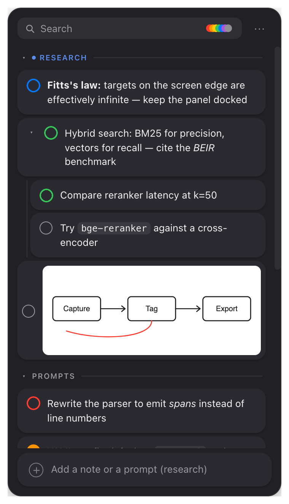
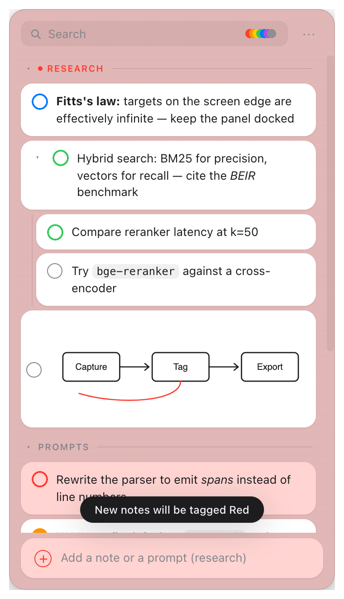
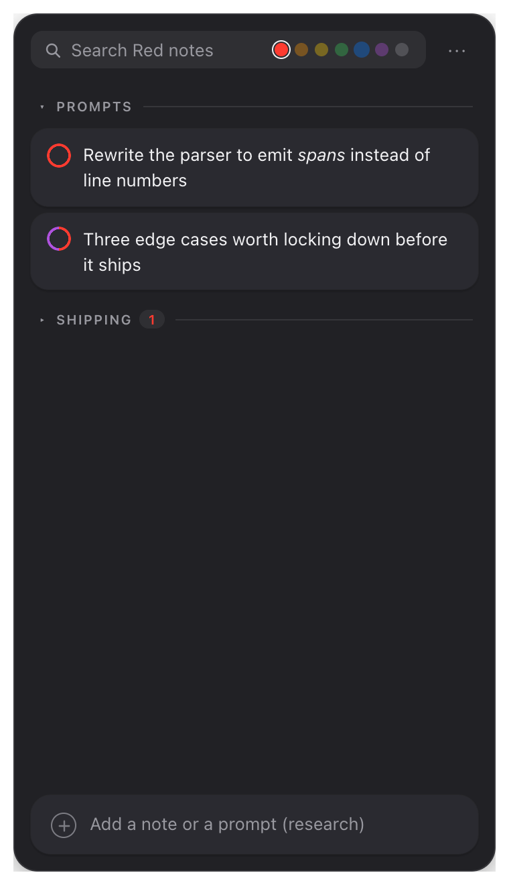
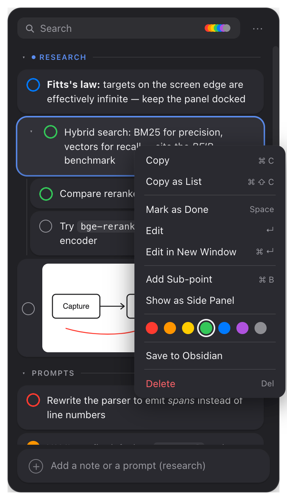
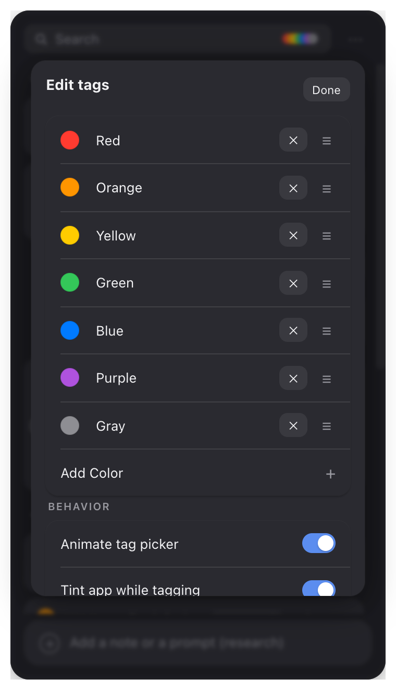
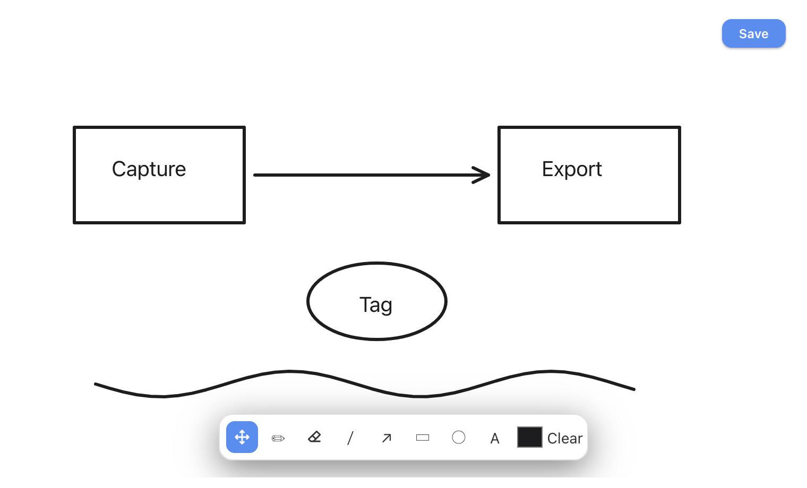

# Cooper — the open-source Copper app for Windows, macOS & Linux

[](https://github.com/TouchMyBar/cooper/releases/latest)
[](https://github.com/TouchMyBar/cooper/releases)
[](LICENSE)
[](https://github.com/TouchMyBar/cooper/actions)

**Cooper** is a free, open-source recreation of **Copper** —
the Mac capture app by **shadcn** — for people who want the same workflow on
**Windows and Linux**, not just macOS. If you searched for a *Copper app for
Windows*, a *Copper alternative*, or an *open-source Copper*, this is it.

> Cooper is an independent community project. It is **not affiliated with or
> endorsed by shadcn** — if you're on a Mac, go buy the original; it's great.

Copper's pitch, which Cooper replicates faithfully: the more you use AI, the
more you collect little things you don't want to lose — an answer worth
keeping, a link, an idea, three follow-up prompts while the current one is
still generating. Cooper combines the useful parts of a **to-do list, a
clipboard, and a scratchpad**, purpose-built for AI-assisted work. It sits
next to where you work, is always one shortcut away, and works with all your
AI apps, terminals, and browsers — ChatGPT, Claude, Cursor, anything.

**Local and private.** No sync, no telemetry, no account. Everything lives in
a single SQLite file on your machine.

<p align="center">
  
  
  
</p>
<p align="center">
  
  
</p>
<p align="center">
  
</p>

## Download

Grab the latest build from **[Releases](https://github.com/TouchMyBar/cooper/releases/latest)** —
no compiling needed:

| OS | File to download |
| --- | --- |
| **Windows** | `Cooper_x.y.z_x64-setup.exe` (installer) or `Cooper_x.y.z_x64_en-US.msi` |
| **macOS** (Intel & Apple Silicon) | `Cooper_x.y.z_universal.dmg` |
| **Linux** | `Cooper_x.y.z_amd64.AppImage` (portable — `chmod +x` and run), or `.deb` / `.rpm` |

First-run notes:

- **Windows**: SmartScreen may warn because the binary is unsigned — click
  *More info → Run anyway*.
- **macOS**: **drag Cooper out of the disk image into Applications and eject the
  image before opening it.** Run from the mounted image, macOS keeps relaunching
  a throwaway read-only copy, and no permission you grant can ever stick.
  Then right-click → *Open* the first time (or
  `xattr -dr com.apple.quarantine /Applications/Cooper.app`), and grant
  **Accessibility** for the double-shift shortcuts. Cooper detects each of these
  states and walks you through whichever one applies.
- **Linux**: the AppImage needs no install. On Wayland use the fallback
  hotkeys (see below).

## How it works

- Select text anywhere → **double-tap Left Shift** → captured.
- Think of a follow-up prompt → **double-tap Right Shift** → Cooper appears,
  type it, keep working.
- Send items back into your AI apps and check them off as you go.

## Shortcuts

| Action | Shortcut |
| --- | --- |
| Capture selected text (any app) | `Left Shift` + `Left Shift` |
| Show / hide Cooper (any app) | `Right Shift` + `Right Shift` |
| Show / hide (fallback) | `Ctrl/Cmd` + `Shift` + `Space` |
| Capture (fallback) | `Ctrl/Cmd` + `Shift` + `C` |
| Switch / create section | `Ctrl/Cmd` + `K` |
| Copy selected · Copy as list | `Ctrl/Cmd` + `C` · `Ctrl/Cmd` + `Shift` + `C` |
| Mark as done / Edit / Delete | `Space` / `Enter` / `Del` |
| Create branch / sub-branch mode | `Ctrl/Cmd` + `B` |
| Zoom in / out / reset | `Ctrl/Cmd` + `+` / `-` / `0` |
| Shortcut sheet | `Ctrl/Cmd` + `/` |

## Features

- **Capture panel** — frameless, always-on-top, docked to the edge of your
  screen, summoned and dismissed entirely from the keyboard.
- **Sections** — type `# Name` to create one; everything you capture lands in
  the active section until you switch (`Ctrl/Cmd+K`). Right-click a header to
  rename, delete, or retarget captures. Type `## Name` to start **fresh**: the
  new section becomes the active area and everything else collapses upward
  into compressed one-line dropdowns (click the `▸` to expand, or just search).
- **Images & files** — drag images or screenshots from your file manager, a
  browser, or another app onto the panel, or just **paste** them with
  `Ctrl/Cmd+V`. Images are stored in Cooper's own folder and shown as
  thumbnails in the list; **click a thumbnail to copy the image back to your
  clipboard** for pasting anywhere. Dropping non-image files or text adds them
  as notes. While hovering you get a Finder-style `+` badge with the count.
- **Focus hand-back** — hiding Cooper with `Esc` returns focus to the app you
  were working in.
- **Inline formatting** — cards render `**bold**`, `*italic*`,
  `~~strikethrough~~`, and `` `code` ``. (Underscore emphasis is intentionally
  unsupported so captured snake_case and `__dunder__` code isn't mangled.)
- **Copy as List** — multi-select items and copy them back out as a Markdown
  list, ready to paste into a prompt.
- **Color tags** — right-click any note (or a whole selection) for Apple's
  Finder-style color dots. A tagged note's done-circle takes on its color, and
  checking it off fills the circle in. Filter from the stacked dots in the
  search bar: click to roll them open, pick a color. Open sections show their
  matches, collapsed ones show a count, and headers still open and close.
- **Tagging mode** — `+` → *Tag New Notes* → pick a color, and every new
  note, capture, image, or drawing gets it until you turn it off. The app
  tints itself in that color so you always know you're in it.
- **Your own palette** — Settings → *Edit tags*: recolor from a palette or the
  system color picker, rename, drag to reorder, add or remove colors, and
  switch the picker animation or app tint off.
- **Drag notes between sections** — hold a note, then drop it on any
  section (even a collapsed one), like moving a file into a folder. Its whole
  branch comes along, and a selection moves together.
- **Branches** — break a note into sub-points up to ten levels deep, inline or
  in a side panel. `Ctrl/Cmd+B` on the last note arms *sub-branch mode* so
  captures nest under it automatically.
- **Drawing pad** — `+` → *Create Drawing…*: pen, line, arrow, rectangle,
  ellipse, and text, plus **Move** and an **Eraser** that removes whatever you
  drag across. Undo covers every step; Save drops it on the board as an image.
- **Save to Obsidian** — right-click → *Save to Obsidian* writes Markdown into
  your current vault, one file per section, images included.
- **Zoom** — `Ctrl/Cmd` + `+` / `-` / `0`, 50–200%, remembered between
  launches.
- **Themes** — System / Light / Dark / **Glass**. Glass is a translucent
  liquid-glass look built on each OS's cheapest compositor effect: Windows DWM
  acrylic, macOS `NSVisualEffectView` vibrancy (GPU-composited, effectively
  free). Linux gets plain translucency; KWin or picom can blur it.
- **Tray app** — closes to the tray, optional start-at-login, single-instance.
- **Your data stays yours** — one SQLite file, plus one-click *Export to
  Markdown* so nothing is ever locked in.

## Building from source

Prerequisites: [Rust](https://rustup.rs), Node 18+, and the
[Tauri 2 platform prerequisites](https://tauri.app/start/prerequisites/)
(WebView2 on Windows — preinstalled on Win 11; `libwebkit2gtk-4.1` etc. on
Linux).

```sh
npm install
npm run tauri dev      # run in development
npm run tauri build    # produce installers/bundles for your OS
```

If you plan to **publish** a binary you built yourself, strip your own paths out
of it first. Rust bakes dependency source paths into panic messages, and
`strip` does not remove them, so an ordinary build embeds your home directory
several hundred times over:

```sh
RUSTFLAGS="--remap-path-prefix=$HOME=/build" npm run tauri build
```

CI already does this. (Cargo's own `trim-paths` would be tidier, but it is still
nightly-only.)

One Tauri 2 codebase (Rust core + web UI in the OS webview) compiles to a
~10 MB native binary on every platform. No Electron.

## Platform notes

- **macOS** — the double-shift shortcuts use a low-level event tap, which needs
  the Accessibility permission (one checkbox: it covers both watching for the
  Shift taps and sending the copy chord). Without it the fallback hotkeys still
  work. Ticking the box takes effect immediately — no relaunch. Cooper shows a
  short setup guide whenever it detects the shortcuts are inert.
  Because the released builds are unsigned, macOS treats **every Cooper update
  as a different app** and silently drops the permission while leaving the
  checkbox visibly ticked. If double-shift stops after an update, remove Cooper
  from the Accessibility list with **−** and add it back. Cooper notices this
  and reopens the guide by itself.
- **Linux** — the raw keyboard hook works on X11; on Wayland use the fallback
  hotkeys.
- **Capture mechanics** — capturing simulates the platform copy chord and
  reads the clipboard. If nothing was selected, your previous clipboard is
  restored untouched.

## Data

- Database: `cooper.db` in the app data directory
  (`%APPDATA%/app.cooper.desktop` on Windows,
  `~/Library/Application Support/app.cooper.desktop` on macOS,
  `~/.local/share/app.cooper.desktop` on Linux).
- `⋯ → Export to Markdown` writes a checklist-style `cooper-export.md` to
  your Documents folder.

## License

[Apache-2.0](LICENSE) — fork it, ship it, build on it.
